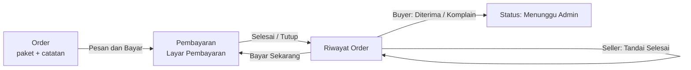

# 02 — Fadiil · OrderPage (Order, Riwayat, Pembayaran)

Panduan pengerjaan modul perjalanan pesanan: tampilan antarmuka, validasi form, modal/bottom sheet interaktif, dan pengelolaan state lokal.

**Halaman dasar:** `OrderPage` → `lib/pages/order_page.dart` (sudah ada).  
**Fokus utama:** **UI & State Management** (Purely UI with States — tanpa integrasi CRUD backend/database langsung).

> **Singkatnya:** kamu pegang **tampilan dan alur perjalanan pesanan**: buyer memilih paket dan memesan jasa, simulasi alur pembayaran, seller memperbarui status selesai di UI, serta buyer menerima atau mengajukan komplain. Semua perubahan status dikelola secara reaktif pada UI State.

---

## Gambaran Singkat

| Halaman | Yang terjadi di sini | Interaksi UI & State |
|---|---|---|
| **Order** | Pilih paket, isi catatan, hitung total harga, tekan Pesan dan Bayar | Form State & Validasi |
| **Pembayaran** | Layar simulasi pembayaran, konfirmasi status bayar | Simulasi Pembayaran & Navigasi |
| **Riwayat Order** | List order, filter chip status, bottom sheet detail & aksi sesuai role | List State, Filter, & Status Transition |

Tombol di Riwayat Order menurut status & role:

| Status | Siapa | Tombol Aksi di UI |
|---|---|---|
| `menunggu_pembayaran` | Buyer | **Bayar Sekarang**, **Cek Status Pembayaran**, **Batalkan** |
| `dibayar` | Seller | **Tandai Selesai** |
| `dikirim` | Buyer | **Pekerjaan Diterima**, **Ajukan Komplain** |
| `menunggu_admin` | Keduanya | *(Hanya info teks: Menunggu peninjauan admin)* |
| `selesai` / `direfund` / `dibatalkan` | Buyer | **Hapus Riwayat** |

### Urutan Kerja
1. [ ] `StatusBadge` (UI badge warna & label status pesanan).
2. [ ] Model State `OrderItem` (struktur data lokal/mock untuk menyimpan pesanan di memori).
3. [ ] Halaman Order: ringkasan jasa, pilihan paket (radio/card), input catatan, kalkulasi total harga, tombol Pesan & Bayar dengan state loading.
4. [ ] `PembayaranPage` (layar simulasi pembayaran dan penanganan callback status selesai/tutup).
5. [ ] Riwayat Order: list order, tab/filter role (Pesanan Saya / Pesanan Masuk), filter chip status, bottom sheet detail.
6. [ ] Modal & Interaksi: Dialog/Bottom Sheet Tandai Selesai (opsional catatan), Komplain (alasan wajib), dialog Batalkan, dan dialog konfirmasi Hapus.

### Ketergantungan Modul
| Kamu memberi | Ke siapa |
|---|---|
| `StatusBadge` | Dipakai di Riwayat Order, Detail Order, dan Manajemen Pembelian |
| `OrderPage(talent)` | Terbuka dari tombol Pesan di Detail Jasa / Navbar |
| `RiwayatOrderPage` | Halaman riwayat order untuk Buyer & Seller |

| Kamu butuh | Dari siapa |
|---|---|
| Model `Talent` | Menampilkan info jasa di form Order |
| Model `Pengguna` / Role | Menentukan tab aktif & hak akses tombol aksi (Pencari / Penyedia) |

---

## Struktur Data & Status (UI State)

### Model `OrderItem` (State Lokal)
Model representasi transaksi pesanan di level UI/State:
- `id`: String identitas order (mis. ID unik/mock acak).
- `talent`: Objek `Talent` yang dipesan.
- `namaJasa`: String nama jasa.
- `buyerId` / `buyerName`: Info pemesan.
- `sellerId` / `sellerName`: Info penyedia.
- `paket`: Pilihan paket (`Basic` / `Standard` / `Premium`).
- `total`: Harga integer sesuai paket.
- `catatan`: Catatan kebutuhan dari buyer.
- `status`: Status pesanan saat ini (`menunggu_pembayaran`, `dibayar`, `dikirim`, `menunggu_admin`, `selesai`, `dibatalkan`, `direfund`).
- `metodeBayar`: String simulasi metode pembayaran (mis. QRIS, Gopay).
- `hasilKerja`: Teks/link hasil pengerjaan dari seller (opsional).
- `alasanKomplain`: Teks alasan dari buyer jika mengajukan komplain.
- `createdAt`: Tanggal pembuatan order (`DateTime`).

### Siklus Perubahan Status (State Transitions)
Semua perubahan status terjadi di dalam state aplikasi:
1. **`menunggu_pembayaran`**: Status awal setelah menekan Pesan di `OrderPage`.
2. **`dibayar`**: Berubah setelah alur pembayaran berhasil diselesaikan.
3. **`dikirim`**: Seller menekan "Tandai Selesai" dan menyertakan catatan/link hasil kerja.
4. **`menunggu_admin`**: Buyer memilih "Pekerjaan Diterima" atau "Ajukan Komplain".
5. **`selesai` / `direfund` / `dibatalkan`**: Status akhir, item dapat dihapus dari daftar riwayat oleh buyer.

---

## Komponen Milikmu

### `StatusBadge` (`lib/components/status_badge.dart`)
Komponen widget `StatusBadge({required String status})` untuk menampilkan label teks dan warna latar belakang sesuai status:

| Status | Label | Warna UI Disarankan |
|---|---|---|
| `menunggu_pembayaran` | Menunggu Pembayaran | Oranye / Amber (`Colors.orange`) |
| `dibayar` | Dibayar | Biru (`Colors.blue`) |
| `dikirim` | Selesai Dikerjakan | Ungu (`Colors.purple`) |
| `menunggu_admin` | Menunggu Persetujuan Admin | Kuning / Amber gelap (`Colors.amber.shade700`) |
| `selesai` | Selesai | Hijau (`Colors.green`) |
| `direfund` | Direfund | Merah (`Colors.red`) |
| `dibatalkan` | Dibatalkan | Abu-abu (`Colors.grey`) |

---

## Halaman 2.1 — Order (`lib/pages/order_page.dart`, sudah ada)

Ditampilkan untuk pengguna role pencari/buyer. Menerima parameter `Talent talent` dan opsional callback navigasi `VoidCallback? onKembali`.

**Isi Layar & State:**
- **Header & Ringkasan Jasa:** Foto talent/jasa, judul jasa, nama penyedia, dan rating.
- **Pilihan Paket (State `selectedPackage`):**
  - Opsi: `Basic`, `Standard`, `Premium`.
  - Tiap opsi menampilkan judul paket dan nominal harga (`talent.hargaPaket(paket)`).
  - Tampilan interaktif (Radio button atau Card terpilih dengan border aksen).
- **Kolom Catatan (TextEditingController):** Input catatan instruksi atau kebutuhan khusus dari pembeli.
- **Rincian & Total Pembayaran:** Nominal harga paket yang otomatis berubah sesuai paket yang dipilih (diformat dengan `currency_formatter`).
- **Tombol Pesan dan Bayar:**
  - State tombol: normal / loading saat memproses.
  - Alur UI:
    1. Validasi pilihan paket dan input catatan.
    2. Tampilkan loading indikator sebentar (simulasi pembuatan pesanan).
    3. Buat objek `OrderItem` baru ke daftar pesanan.
    4. Navigasi ke `PembayaranPage`.
    5. Setelah halaman pembayaran ditutup, perbarui status order sesuai hasil bayar, lalu arahkan ke `RiwayatOrderPage`.

---

## Halaman 2.2 — Riwayat Order (`lib/pages/riwayat_order_page.dart`, baru)

Menampilkan daftar pesanan dengan UI interaktif sesuai role pengguna:

| Role | Tab Tampilan |
|---|---|
| `pencari` (Buyer) | **Pesanan Saya** |
| `penyedia` (Seller) | **Pesanan Masuk** |

**Fitur Tampilan UI & State:**
- **Filter Chip Status:** Deretan horizontal chip (Semua, Menunggu Pembayaran, Dibayar, Selesai Dikerjakan, Menunggu Admin, Selesai, Dibatalkan). Memilih chip akan memfilter list order di state secara real-time.
- **Card Item Order:**
  - Menampilkan nama jasa, label paket, total harga (`CurrencyFormatter.format`), tanggal order, dan `StatusBadge`.
  - Tampilan empty state jika list order kosong ("Belum ada pesanan").
- **Bottom Sheet Detail Order (saat item di-tap):**
  - Rincian lengkap: ID order, nama seller/buyer, rincian paket, total pembayaran, catatan, dan hasil kerja (jika sudah diisi seller).
  - **Tombol Aksi Dinamis (mengubah state item secara lokal):**
    - **Bayar Sekarang** (Buyer, status `menunggu_pembayaran`): Membuka ulang `PembayaranPage`.
    - **Cek Status Pembayaran** (Buyer, status `menunggu_pembayaran`): Simulasi verifikasi bayar, mengubah status ke `dibayar` dan update UI.
    - **Batalkan Pesanan** (Buyer, status `menunggu_pembayaran`): Menampilkan dialog konfirmasi pembatalan. Jika disetujui, update status ke `dibatalkan`.
    - **Tandai Selesai** (Seller, status `dibayar`): Menampilkan bottom sheet/dialog dengan input teks hasil kerja (opsional), lalu update status ke `dikirim`.
    - **Pekerjaan Diterima** (Buyer, status `dikirim`): Konfirmasi penyelesaian pekerjaan, update status ke `menunggu_admin`.
    - **Ajukan Komplain** (Buyer, status `dikirim`): Menampilkan modal input alasan komplain (wajib diisi). Setelah disubmit, update status ke `menunggu_admin`.
    - **Hapus Riwayat** (Buyer, status `selesai` / `dibatalkan` / `direfund`): Dialog konfirmasi hapus, menghapus item dari list state.

---

## Halaman 2.3 — Pembayaran (`lib/pages/pembayaran_page.dart`, baru)

Layar simulasi pembayaran interaktif untuk menyelesaikan transaksi pesanan.

**Isi Layar & Interaksi:**
- **AppBar "Pembayaran":** Memiliki tombol tutup (X).
  - Menampilkan dialog konfirmasi "Keluar dari pembayaran? Pesanan Anda akan tetap tersimpan di status Menunggu Pembayaran".
  - Tombol Batal / Ya, Keluar (`Navigator.pop(context, false)`).
- **Rincian Tagihan & Metode Pembayaran:**
  - Menampilkan total nominal yang harus dibayar.
  - Pilihan metode pembayaran (mis. QRIS, Virtual Account / Transfer Bank, E-Wallet).
  - Tampilan instruksi pembayaran (kode bayar / barcode simulasi, batas waktu pembayaran).
- **Tombol "Simulasikan Pembayaran Berhasil":**
  - Menampilkan loading sebentar lalu menutup halaman pembayaran dengan hasil sukses (`Navigator.pop(context, true)`).
- Hasil pop boolean (`true`/`false`) diterima pemanggil untuk memperbarui status pesanan menjadi `dibayar` atau tetap `menunggu_pembayaran`.

---

## Kriteria Selesai (Purely UI with States)
- [ ] Pengguna role pencari dapat mengisi form Order (pilih paket, catatan, kalkulasi total reaktif).
- [ ] Menekan tombol "Pesan dan Bayar" menampilkan state loading dan berpindah ke layar pembayaran.
- [ ] Layar pembayaran dapat diselesaikan atau ditutup dengan pembaruan state yang sesuai (`dibayar` vs `menunggu_pembayaran`).
- [ ] Halaman Riwayat Order menampilkan tab sesuai role (Pesanan Saya / Pesanan Masuk).
- [ ] Filter chip status berfungsi menyaring list pesanan secara reaktif.
- [ ] Modal/dialog aksi berfungsi mengubah state pesanan di memori secara interaktif:
  - Pembatalan pesanan (dengan konfirmasi).
  - Pengiriman hasil kerja oleh seller.
  - Penerimaan hasil kerja atau pengajuan komplain oleh buyer (dengan validasi alasan).
  - Penghapusan item pada status akhir dari list state.
- [ ] Komponen `StatusBadge` menampilkan label dan variasi warna yang rapi sesuai status.
